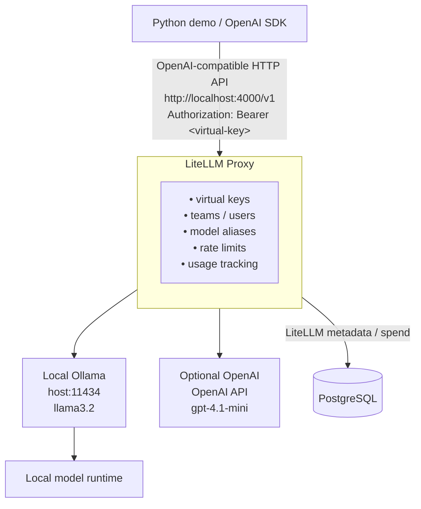

# LiteLLM Learning Lab

A small, hands-on project for understanding **LiteLLM Proxy as an API gateway**.

The examples use a fictional **Bookstore Support** service rather than a finance, fraud, or rate-limit example copied from another tutorial. The three Python demos build on one another:

1. **Basic chat** — call a model through LiteLLM using the OpenAI-compatible API.
2. **Model routing** — select different model aliases for quick classification and more detailed responses.
3. **Rate limits** — send concurrent requests and observe what happens when a virtual key reaches its configured limits.

The project supports two upstream options:

- **Local-only:** Ollama running on your machine. No provider API key or cloud model account is needed.
- **Cloud option:** OpenAI, when you supply your own `OPENAI_API_KEY`.

The Python examples always talk to the LiteLLM Proxy. They do not call Ollama or OpenAI directly.

---

## Repository information

| Field | Value |
|---|---|
| Suggested repository name | `litellm-learning-lab` |
| Title | LiteLLM Learning Lab |
| Description | Hands-on LiteLLM Proxy examples: local Ollama and optional OpenAI, model routing, virtual keys, and rate limits. |
| Suggested topics | `litellm`, `llm`, `api-gateway`, `ollama`, `openai`, `python`, `docker`, `postgresql` |
| License | MIT |

## Architecture




PostgreSQL stores LiteLLM's persistent proxy data (for example, key and spend/usage metadata). It is not the model runtime. Ollama runs separately on the host in this setup.

## Prerequisites

- Ubuntu/Linux, macOS, or Windows with Docker support.
- Docker Engine and Docker Compose plugin.
- Python 3.10+ (the examples use the OpenAI Python SDK).
- Ollama for local model execution, or an OpenAI API key for the cloud option.
- Enough RAM for the Ollama model you choose. Smaller models are a better starting point on machines with limited memory.

## 1. Clone and prepare

```bash
git clone https://github.com/<your-user>/litellm-learning-lab.git
cd litellm-learning-lab

cp .env.example .env
```

Edit `.env`. At minimum, replace the sample master key and salt with strong random values. Do not commit `.env`.

Generate secrets, for example:

```bash
openssl rand -hex 32
```

Use one generated value for `LITELLM_MASTER_KEY` and another for `LITELLM_SALT_KEY`. Keep the salt stable once LiteLLM has stored encrypted credentials; changing it later can make previously encrypted values unreadable. Back it up securely.

## 2. Local-only setup with Ollama

Install and start Ollama on the **host machine**, not inside the LiteLLM container.

Pull the default example model:

```bash
ollama pull llama3.2
ollama list
```

By default, the LiteLLM container needs to reach Ollama through the host gateway. On Linux, `host.docker.internal` is not guaranteed to resolve automatically. This repository adds the host-gateway mapping in `docker-compose.yml`.

Ollama may listen only on `127.0.0.1` by default. A container cannot reach a service that is bound only to the host loopback interface. For a manually started Ollama process, stop it and start it with:

```bash
OLLAMA_HOST=0.0.0.0:11434 ollama serve
```

Keep that terminal running. Verify:

```bash
ss -lntp | grep 11434
```

You should see `0.0.0.0:11434` (or another host-reachable bind address), not only `127.0.0.1:11434`.

> **Security:** binding to `0.0.0.0` exposes Ollama on the machine's network interfaces. Use a trusted network, restrict access with your firewall, and never expose port 11434 directly to the public internet.

The included config uses:

```yaml
api_base: http://host.docker.internal:11434
```

If your Docker environment does not support the host-gateway mapping, use the host's reachable IP address in `config.yaml` instead. Do not use `127.0.0.1` there: from inside the LiteLLM container, that points back to the container itself.

## 3. Optional OpenAI setup

If you want to use OpenAI as an upstream provider, set your own key in `.env`:

```dotenv
OPENAI_API_KEY=your-real-openai-api-key
```

Then uncomment the `cloud-gpt` model entry in `config.yaml` and restart LiteLLM.

If you do not have an OpenAI API key, leave that model entry commented out and use the local Ollama model. A LiteLLM **virtual key** is not an OpenAI provider key: the virtual key authenticates your application to your LiteLLM Proxy; the provider key authenticates LiteLLM to the upstream provider.

## 4. Start LiteLLM and PostgreSQL

```bash
docker compose up -d
docker compose ps
docker compose logs -f litellm
```

Open the LiteLLM UI:

- Proxy: `http://localhost:4000`
- API base URL for SDK clients: `http://localhost:4000/v1`

The UI path and available controls can vary by LiteLLM version. Sign in with the master key when prompted.

## 5. Create a virtual key

Create a key in the LiteLLM UI (or use the supported key-management API for your installed version).

For a first test, create a key that is allowed to use `local-llama`. Copy the generated key and set it in your shell:

```bash
export LITELLM_VIRTUAL_KEY="your-generated-virtual-key"
```

Do not put real keys in source code, screenshots, commits, or issue reports.

A virtual key can have model access, spend limits, RPM/TPM limits, team association, and other restrictions depending on how it is created. The key must be allowed to access the model alias used by the client.

## 6. Install Python dependencies

```bash
python3 -m venv .venv
source .venv/bin/activate
python -m pip install --upgrade pip
pip install -r requirements.txt
```

## 7. Run the three demos

Run from the repository root:

```bash
python demos/01_basic_chat.py
python demos/02_model_routing.py
python demos/03_rate_limits.py
```

For the second demo, make sure your virtual key is permitted to call both aliases you intend to test. The cloud alias exists only if you enabled it in `config.yaml` and supplied an OpenAI key.

The rate-limit demo sends several requests concurrently. Configure a deliberately low RPM limit on a **dedicated test virtual key** in the LiteLLM UI first. Do not experiment with aggressive concurrency against a production key or a shared team key.

## Environment variables

| Variable | Purpose |
|---|---|
| `LITELLM_MASTER_KEY` | Admin/master credential for the proxy. Keep secret. |
| `LITELLM_SALT_KEY` | Salt used by LiteLLM for encryption-related operations. Keep stable and secret. |
| `DATABASE_URL` | PostgreSQL connection string used by LiteLLM. |
| `OPENAI_API_KEY` | Optional upstream OpenAI provider key. Not required for local Ollama. |
| `LITELLM_VIRTUAL_KEY` | Key generated by LiteLLM for the Python client. |

## Troubleshooting notes

### `AuthenticationError` / missing OpenAI API key

- Confirm whether the request is using the `cloud-gpt` alias or `local-llama`.
- A LiteLLM virtual key does not replace an OpenAI provider API key.
- For local-only usage, call `local-llama` and keep the cloud model entry disabled.
- For cloud usage, set `OPENAI_API_KEY` in `.env`, enable the cloud entry, and restart the proxy.

### `Connection refused` or connection reset from the Python client

Check each hop separately:

```bash
curl http://localhost:4000/health/liveliness
docker compose logs --tail=200 litellm
ollama list
curl http://localhost:11434/api/tags
```

A reset can be caused by a restarting container, an out-of-memory kill, a proxy startup problem, or an upstream connectivity issue. Inspect Docker logs and container state rather than assuming the Python SDK is the root cause.

### `Name or service not known` for `host.docker.internal`

On Linux, this hostname may not resolve in a container unless a host-gateway mapping is configured. This project includes:

```yaml
extra_hosts:
  - "host.docker.internal:host-gateway"
```

Recreate the container after changing Compose configuration:

```bash
docker compose up -d --force-recreate litellm
```

You can also use a host-reachable IP in `api_base`, but that address can change when your network changes.

### Ollama is listening on `127.0.0.1:11434`

The container cannot access the host's loopback-only listener. If Ollama was started manually:

```bash
# Stop the existing `ollama serve` with Ctrl+C, then:
OLLAMA_HOST=0.0.0.0:11434 ollama serve
```

If Ollama is managed by a desktop app or service manager, configure the environment variable through that manager instead of creating an unrelated systemd service. Verify the process and service manager before changing how Ollama starts.

### `getent` or `curl` is missing inside the LiteLLM container

Minimal containers often omit diagnostic utilities. That does not prove networking is broken. Use a temporary diagnostic container or Python if available. For example:

```bash
docker exec appliedai-litellm python -c \
"import urllib.request; print(urllib.request.urlopen('http://host.docker.internal:11434/api/tags', timeout=5).read().decode())"
```

The container name above is only an example; use the name shown by `docker compose ps`.

### Virtual key rejected / model not allowed

- Check that the client uses the LiteLLM virtual key, not the provider key.
- Check that the key is active and allowed to access the requested model alias.
- Check team membership, model restrictions, spend limits, and rate limits.
- Make sure the Python `model` value exactly matches the `model_name` alias in `config.yaml`.

### Rate-limit demo does not produce a 429

A limit is not automatic just because the demo is concurrent. Configure a low RPM/TPM limit on the test virtual key (or its team) in LiteLLM, then send enough requests within the same window. Limits can be enforced at different scopes and may depend on your LiteLLM version and key/team configuration.

### PostgreSQL or proxy startup failure

```bash
docker compose ps
docker compose logs --tail=200 db
docker compose logs --tail=200 litellm
```

Confirm the database credentials in `.env` match the Compose settings and that the database health check passes before debugging model calls.

## Important operational and security practices

- `.env` is ignored by Git. Commit `.env.example`, never `.env`.
- Replace all sample secrets before running this outside a throwaway lab.
- If a key has ever been committed or shared, revoke/rotate it. Deleting it from the latest file does not remove it from Git history.
- Do not expose the LiteLLM admin UI or master key to an untrusted network.
- Do not expose Ollama's unauthenticated API to the internet.
- Use dedicated virtual keys for experiments and give each the minimum model access and limits needed.
- Pin image versions for repeatable deployments; review LiteLLM release notes before upgrading.

## What this lab teaches

| Concept | Where to look |
|---|---|
| OpenAI-compatible client calling a gateway | `demos/01_basic_chat.py` |
| Model aliases and upstream routing | `config.yaml`, `demos/02_model_routing.py` |
| Virtual-key RPM limits and concurrency | `demos/03_rate_limits.py` |
| Proxy + database containers | `docker-compose.yml` |
| Local vs cloud provider configuration | `config.yaml`, `.env.example` |
| Troubleshooting container-to-host networking | this README and `docs/interactive-guide.html` |

## License

MIT. See [LICENSE](LICENSE).
